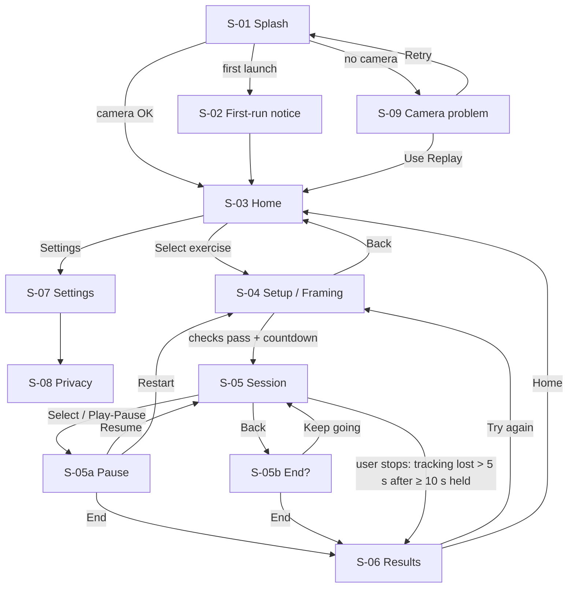

# FormVision — Sitemap and Navigation

The screens, the routes between them, the D-pad focus rules, and the remote key mapping. Requirement IDs (FR-*, US-*) refer to [PRD.md](PRD.md). Visual rules are in [BRANDING.md](BRANDING.md).

Target canvas: **1920×1080**, with a title-safe area inset 5% on every side (96 px left/right, 54 px top/bottom).

---

## 1. Screen inventory

| ID | Screen | Route | Tier | Purpose |
|---|---|---|---|---|
| S-01 | Splash / Boot | `boot` | P0 | Load models, check camera, route onward |
| S-02 | First-run notice | `welcome` | P0 | One-time privacy + safety disclaimer |
| S-03 | Home | `home` | P0 | Pick an exercise; reach Settings |
| S-04 | Setup / Framing | `setup/:exercise` | P0 | Get the user into frame and side-on; countdown |
| S-05 | Session | `session/:exercise` | P0 | Live coaching (the hero screen) |
| S-05a | Pause overlay | modal on S-05 | P0 | Resume / Restart / End |
| S-05b | End-session confirm | modal on S-05 | P0 | Confirm leaving mid-session |
| S-06 | Results | `results/:sessionId` | P1 | Session summary + takeaway |
| S-07 | Settings | `settings` | P1 | Camera source, voice, overlay, debug HUD |
| S-08 | Privacy | `settings/privacy` | P1 | What stays on the device, and the exact payload that is sent |
| S-09 | Camera problem | `camera-error` | P0 | No camera / permission denied / lost camera; offer Replay |

Exercises (`:exercise`): `plank` (P0) and `squat` (P2). Each exercise without an implementation is hidden, not disabled.

## 2. Flow



**Back-stack rules**
- Back on S-03 Home exits the app (platform default).
- S-04 → S-05 *replaces* Setup in the stack, so Back from Session goes to the confirm dialog, never to Setup.
- S-06 Results *replaces* Session, so Back on Results goes to Home.
- Modals (S-05a, S-05b) close on Back.

## 3. Screen specs

### S-01 Splash / Boot
- Contents: logo, product name, one status line ("Starting camera…", "Loading pose model…").
- Logic, in order: load the pose model → enumerate cameras → open the default source → first landmarks received or a timeout of 4 s.
- Routes to S-02 (first launch), S-03 (OK), or S-09 (camera failure).
- No focusable elements.

### S-02 First-run notice
- Three short points:
  1. "Video stays on this device."
  2. "Only joint angles are sent to create voice tips."
  3. "Not medical advice — stop if anything hurts."
- Focusable: **Got it** (default focus), **Privacy details** → S-08.

### S-03 Home
```
┌──────────────────────────────────────────────────────────────┐
│ FormVision                                       ⚙ Settings  │
│                                                              │
│  ┌───────────────┐  ┌───────────────┐                        │
│  │  PLANK        │  │  SQUAT  (P2)  │                        │
│  │  Core · 60 s  │  │  Legs · 10    │                        │
│  └───────────────┘  └───────────────┘                        │
│                                                              │
│ Camera: USB webcam ●  Live           Voice coach: On         │
└──────────────────────────────────────────────────────────────┘
```
- Focus grid: one row of exercise cards; Settings sits above the row on the right.
- Default focus: first exercise card.
- Status bar (not focusable): active camera source with a Live/Replay badge, and voice coach state.

### S-04 Setup / Framing
- Full-screen live feed with a ghost silhouette guide. A side-on plank outline shows where the body should sit.
- Checklist, ticked live (FR-6):
  - ☐ Full body in view
  - ☐ Side-on to camera
  - ☐ Hold still
- When all three are ticked for 1.5 s, a 3-2-1 countdown starts (FR-7). If any check fails during the countdown, the countdown cancels.
- Focusable: **Back** only. The screen advances on its own; nothing to press.
- If the camera is lost here, the app goes to S-09.

### S-05 Session (hero)
```
┌─────────────────────────────────────┬────────────────────────┐
│                                     │   TARGET FORM          │
│   LIVE FEED + SKELETON OVERLAY      │   (reference pose)     │
│                                     │                        │
│                                     │   00:42  held          │
│                                     │   ███████░░ 78% good   │
│                                     │                        │
│                                     │  ▲ "Hips up a couple   │
│                                     │     of inches"         │
└─────────────────────────────────────┴────────────────────────┘
          ~60% width                          ~40% width
```
- Left: camera feed mirrored horizontally. The overlay is drawn in the same mirrored space.
- Right column, top to bottom:
  - Target-form illustration.
  - Hold timer (FR-16).
  - Good-form meter.
  - Cue card: the last spoken cue as text, held for 4 s.
  - Tracking-lost banner when FR-5 fires.
- Debug HUD (optional, Settings): fps, inference ms, body-line angle, state, cue latency. Bottom-left corner.
- Nothing is focusable during the session. The remote works only through key handlers (§4).

### S-05a Pause overlay
- Dims the session. The timer is frozen.
- Buttons: **Resume** (default), **Restart**, **End**.

### S-05b End-session confirm
- "End this session?"
- Buttons: **Keep going** (default), **End**.

### S-06 Results
- Shows:
  - Time held.
  - % in good form.
  - Fault counts (hip sag / hip pike).
  - One-line takeaway (FR-17).
- Buttons: **Try again** (default), **Home**.

### S-07 Settings
Vertical list. Left/Right changes a value; Select toggles it.

| Row | Values |
|---|---|
| Camera source | each detected camera · Replay |
| Voice coach | On / Off |
| Voice volume | 0–10 |
| Skeleton overlay | On / Off |
| Debug HUD | On / Off |
| Privacy | → S-08 |

### S-08 Privacy
- Plain-language explanation and a literal example of the cue payload (TECH-SPEC §7.1), rendered as a code block.
- Back returns to S-07.

### S-09 Camera problem
- States the specific cause: no camera found / permission denied / camera disconnected.
- Buttons: **Retry** (default), **Use Replay**.
- "Use Replay" sets the source to Replay and goes to S-03, where the Replay badge stays visible.

## 4. Remote key map

| Key | S-03 Home / S-07 / modals | S-04 Setup | S-05 Session | S-06 Results |
|---|---|---|---|---|
| D-pad ↑↓←→ | Move focus | — | — | Move focus |
| Select (center) | Activate | — | Pause (S-05a) | Activate |
| Back | Exit / up one level | → S-03 | End? (S-05b) | → S-03 |
| Play/Pause | — | — | Pause / Resume | — |
| Menu (≡) | → S-07 from Home | — | Toggle debug HUD | — |
| Voice (mic) | Platform Alexa. In-app intents are P2 **[VERIFY]** | — | — | — |

## 5. Focus rules
- Every focusable screen has exactly one default focus, listed in §3.
- Focus never lands on a non-interactive element.
- Focus wraps within a row only. It never jumps rows unexpectedly.
- The focus ring style is defined in BRANDING §6. Focus must be visible from 3 m.
- When a modal opens, focus is trapped in it. When the modal closes, focus returns to where it was before the modal opened.

## 6. Audio map

| Event | Sound |
|---|---|
| Countdown tick (3, 2, 1) | Short tick |
| Session start | Rising two-note "go" |
| Fault confirmed | Spoken cue only (no extra sound; avoids clutter) |
| Fix confirmed | Success chime |
| Tracking lost | Soft low tone, plus the spoken line "Step back into view" (local) |
| Session end | Resolve chime |
