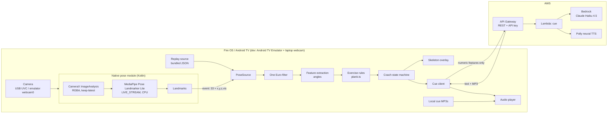
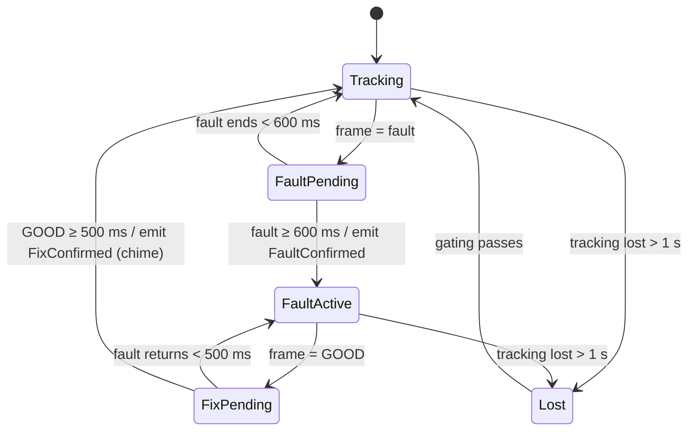
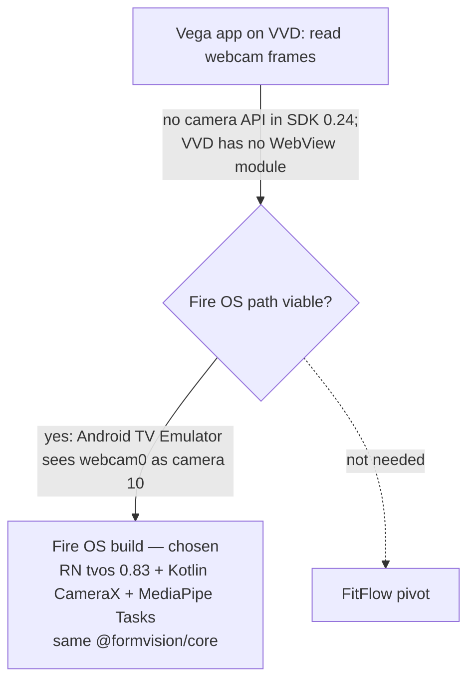

# FormVision — Technical Specification

How to build what [PRD.md](PRD.md) requires. Screens are in [SITEMAP.md](SITEMAP.md); visual tokens are in [BRANDING.md](BRANDING.md).

Items tagged **[VERIFY]** are unconfirmed platform facts. Every one of them has a fallback in this doc.

---

## 1. Architecture



**Invariant:** camera frames exist only inside the native module's memory. The JS layer receives landmarks, never pixels. The network receives derived numbers and enums, never landmarks or pixels.

## 2. Stack

| Layer | Choice | Notes |
|---|---|---|
| App | React Native 0.83 for TV (`react-native-tvos` 0.83.0-0), Android / Fire OS | Same RN version as Vega SDK 0.24's default template, so UI code ports if Vega gains a camera API |
| Language | TypeScript (strict), Kotlin for the native module | |
| Native module | Kotlin RN module `FormVisionPose` + view `FormVisionCameraPreview` (`app/android/.../pose/`) | Legacy-module API through RN's New Architecture interop layer |
| Pose model | MediaPipe Pose Landmarker Lite (`pose_landmarker_lite.task`, 33 BlazePose keypoints) via `com.google.mediapipe:tasks-vision:0.10.33` | Android has first-party MediaPipe Tasks, so no custom TFLite port (§4.2) |
| Camera | CameraX 1.5.2 (`camera-camera2`, `camera-lifecycle`, `camera-view`) | Preview + ImageAnalysis bound to the activity lifecycle |
| Overlay | Absolutely-positioned RN `View`s (joints + rotated bars) | No graphics-library dependency |
| Backend | AWS CDK (TypeScript): API Gateway REST + Lambda (Node.js 22) | One stack, `cdk deploy` / `cdk destroy` |
| LLM | Bedrock, Claude Haiku 4.5 via cross-region inference profile | Model ID `anthropic.claude-haiku-4-5-20251001-v1:0` with a regional prefix **[VERIFY in console]** |
| TTS | Amazon Polly, neural engine, MP3 22.05 kHz | The same voice renders the local fallback cues |
| Tests | Jest (app logic + Lambda) | Fixtures are recorded landmark JSON |
| Dev tooling | Android SDK + emulator (AVD `fv_tv`, `system-images;android-36;android-tv;x86_64`, `hw.camera.front = webcam0`, `hw.camera.back = none`, 4 cores, `-gpu swiftshader_indirect`), JDK 17 | Vega tooling findings are in `FRICTION-LOG.md` |

## 3. Repository layout

```
/
├── packages/core/               @formvision/core — pure TypeScript, no React Native or platform imports
│   ├── src/
│   │   ├── pose.ts              PoseFrame, Joint, model keypoint index maps
│   │   ├── smoothing.ts         One Euro filter + PoseSmoother (stale/visibility handling)
│   │   ├── geometry.ts          Angles, signed hip offset, tilt
│   │   ├── plank.ts             Plank classifier + thresholds, side selection, tracking lost
│   │   ├── coach.ts             Debounce state machine + cue policy
│   │   └── session.ts           Aggregates for Results
│   └── test/                    Jest (synthetic poses; replay fixtures later)
├── app/                         React Native TV app (Android / Fire OS); depends on packages/core
│   ├── App.tsx                  Camera permission → Session
│   ├── src/
│   │   ├── screens/             SessionScreen (S-05); Boot, Welcome, Home, Setup, Results, Settings, Privacy, CameraError to come
│   │   ├── pose/native.ts       Typed bindings for FormVisionPose + CameraPreview
│   │   ├── cue/                 cueClient.ts (API call, timeout, fallback race), audio.ts (queue, ducking)
│   │   └── ui/                  theme.ts (BRANDING tokens), Skeleton.tsx
│   └── android/app/src/main/
│       ├── java/com/formvision/coach/pose/   PoseCamera.kt (CameraX + MediaPipe), PoseModule.kt (RN module, view, package)
│       └── assets/pose_landmarker_lite.task  Pose model (stored uncompressed)
├── backend/
│   ├── bin/app.ts               CDK entry
│   ├── lib/stack.ts             API GW, Lambda, IAM, usage plan
│   └── lambda/cue/              handler.ts, prompt.ts, validate.ts
├── tools/
│   ├── render-cues.ts           Polly → app/assets/cues/*.mp3
│   └── record-landmarks.md      How to capture replay fixtures
├── FRICTION-LOG.md
└── PRD.md, SITEMAP.md, BRANDING.md, TECH-SPEC.md, …
```

## 4. Native pose module

### 4.1 Responsibilities (`PoseCamera.kt`)
1. Bind CameraX `Preview` and `ImageAnalysis` to the activity lifecycle. Target 640×480, `STRATEGY_KEEP_ONLY_LATEST`, RGBA output. Prefer the front camera, then the back camera, then any camera.
2. Submit at most one frame to the model at a time (LIVE_STREAM mode), capped by `maxFps`. Busy frames are dropped, never queued.
3. Rotate the frame bitmap by the camera's rotation plus `contentRotationDeg` (from `start()`) before MediaPipe, and report the upright size. On TV, CameraX target rotation is chosen so the HAL's sensor-orientation claim is ignored (`uprightTargetRotation`). The emulator's webcam bridge delivers frames flipped, so `app/src/config.ts` sets `CAMERA_CONTENT_ROTATION_DEG = 180` (checked against a raw `ffmpeg` capture of `/dev/video0`); real TV webcams need 0.
4. Emit one `onPose` event per result: flat `[x, y, z, visibility] × 33`, normalised, plus `inferMs` (submit → result).
5. Render the preview in a native `PreviewView` inside `PreviewContainer` (`FormVisionCameraPreview`, FIT_CENTER, mirrored by default). `PoseCamera` pushes the same content rotation to the container, which rotates the view and lays it out with width and height swapped. The JS overlay uses the same letterbox mapping on the upright frame size.

### 4.2 Why MediaPipe Tasks, not a TFLite port
On Android, MediaPipe ships a maintained Tasks AAR with the pose models. The TFLite-C-API plan only existed because Vega has no MediaPipe build. The `blazepose_lite` joint map in `@formvision/core` matches the Tasks output index-for-index.

### 4.3 JS interface (`app/src/pose/native.ts`)

```ts
export type CameraInfo = { id: string; label: string; kind: 'builtin' | 'usb' };
// PoseFrame comes from @formvision/core: { t, w, h, kp: number[] /* [x,y,z,vis] × 33 */, inferMs }
interface PoseNativeModule {
  listCameras(): Promise<CameraInfo[]>;
  start(cameraId: string, opts: { maxFps: number }): Promise<void>;
  stop(): Promise<void>;
  // events: 'onPose' (PoseFrame), 'onCameraError' ({ code: 'NOT_FOUND'|'DENIED'|'DISCONNECTED'; message })
}
```

The keypoint array is flat to keep the event payload small. Pixels never cross the bridge.

### 4.4 Canonical joints
JS maps model indices to a single `Joint` enum so the rules never depend on the model. Live builds use `blazepose_lite`; the MoveNet map stays for the replay tooling.

| Joint | MoveNet idx | BlazePose idx |
|---|---|---|
| L/R shoulder | 5 / 6 | 11 / 12 |
| L/R hip | 11 / 12 | 23 / 24 |
| L/R knee | 13 / 14 | 25 / 26 |
| L/R ankle | 15 / 16 | 27 / 28 |
| L/R elbow | 7 / 8 | 13 / 14 |
| L/R wrist | 9 / 10 | 15 / 16 |

## 5. Pose pipeline (JS)

### 5.1 Sources
`PoseSource` interface: `start()`, `stop()`, `subscribe(cb: (PoseFrame) => void)`.
- `LivePoseSource` wraps the native module.
- `ReplayPoseSource` reads `assets/replays/*.json` and emits frames at their recorded timestamps, looping. The same downstream code runs on both sources.

### 5.2 Smoothing
A One Euro filter on every keypoint coordinate (start values `minCutoff = 1.0`, `beta = 0.01`, `dCutoff = 1.0`). Tune these on replay clips. A keypoint with `vis < 0.5` doesn't update its filter; it holds its last value and is flagged stale.

### 5.3 Visibility gating
- **Side selection:** for side-on exercises, use whichever body side (L or R) has the higher mean visibility across shoulder/hip/ankle. Re-evaluate every 1 s to avoid flipping.
- **Tracking lost (FR-5):** the selected side has any required joint stale for > 1000 ms.

## 6. Coaching logic

### 6.1 Plank features
On the selected side, with S = shoulder, H = hip, A = ankle (image coordinates, y grows downward):
- `bodyLine = angle(S, H, A)` in degrees (180 = straight).
- `hipOffset` = signed perpendicular distance of H from line SA, normalised by |SA|. Positive means H is **below** the line (sag); negative means **above** it (pike).
- `torsoTilt` = angle of SA from horizontal. The user must be in plank orientation: `torsoTilt < 35°`.

### 6.2 Classification (with hysteresis)

| State | Enter when | Exit when |
|---|---|---|
| `GOOD` | `bodyLine ≥ 167°` | — |
| `HIP_SAG` | `bodyLine < 160°` and `hipOffset > 0` | `bodyLine ≥ 167°` |
| `HIP_PIKE` | `bodyLine < 160°` and `hipOffset < 0` | `bodyLine ≥ 167°` |
| `UNKNOWN` | tracking lost or `torsoTilt ≥ 35°` | gating passes |

Between 160° and 167°, the previous state holds. `severityDeg = 180 − bodyLine`. All thresholds live in `plank.ts` as named constants and are tuned against labelled replay clips. The angles shown are starting points, not validated values.

### 6.3 Coach state machine



Each `FaultConfirmed` is checked against the cue policy (FR-12):
- A cue is allowed if `now − lastCueAt ≥ 4 s`.
- The same fault type within 8 s is allowed only if `severityDeg` has grown by ≥ 10.
- Overlay state changes ignore the cue policy: they are immediate.

### 6.4 Cue delivery (race with fallback)

```
on FaultConfirmed(f):
  requestId = uuid()
  start POST /v1/cue  (timeout 3 s)
  after 1200 ms, if no response for requestId → play local cue for f.type, mark requestId stale
  on response: if requestId not stale and no cue playing → play response audio
                else drop
```

- **Local cues:** `tools/render-cues.ts` renders 3–4 variants per fault type plus tracking-lost and fixed lines (BRANDING §2) with the production Polly voice, writing `assets/cues/manifest.json`. Variants rotate so the user doesn't hear the same line twice in a row.
- **Network unavailable** (NFR-6): skip the request and play the local cue immediately.
- **Audio queue:** at most one cue at a time. A new cue never interrupts a cue that is playing; it is dropped. The chime may overlap speech.

### 6.5 Session aggregates
`session.ts` accumulates: held ms (state ≠ `UNKNOWN` and not paused), ms per state, confirmed fault counts by type, and worst `severityDeg`. Results (FR-17) are computed from these.

## 7. Backend API

Base URL `https://{api-id}.execute-api.{region}.amazonaws.com/prod`. Every request carries the header `x-api-key`.

### 7.1 `POST /v1/cue`

Request (this is the literal payload the Privacy screen shows):
```json
{
  "v": 1,
  "exercise": "plank",
  "fault": "HIP_SAG",
  "severityDeg": 18,
  "heldSec": 34,
  "faultCount": 2,
  "lastCue": "Hips up a little — squeeze your glutes.",
  "locale": "en-US"
}
```

Response `200`:
```json
{ "text": "Lift your hips two inches and brace.", "audio": { "format": "mp3", "base64": "…" }, "ms": 640 }
```

Validation (Lambda, before calling Bedrock):
- `exercise`/`fault` must be from the enum.
- Numbers must be in range.
- `lastCue` ≤ 120 chars.
- Unknown fields are rejected.
- Validation failure → `400`.

### 7.2 `POST /v1/summary`
Request: `{ v, exercise, heldSec, goodPct, faults: { HIP_SAG: n, HIP_PIKE: n }, worstSeverityDeg }`.
Response: `{ text }` (no audio).
The app uses a local template if this call fails.

### 7.3 Lambda: prompt and output guard
- Bedrock call settings:
  - Converse API.
  - Model: Claude Haiku 4.5 inference profile.
  - `maxTokens: 40`.
  - `temperature: 0.4`.
- The system prompt is static (cacheable). It contains the BRANDING §2 cue rules and examples, plus "Respond with the cue sentence only."
- User message: the validated request JSON.
- **Output guard:** strip quotes/whitespace. Reject the output if:
  - it has more than 12 words, or
  - it is empty, or
  - it contains a banned term (injury, damage, pain, diagnose, weight, fat).
- On rejection or Bedrock error, return a template cue for the fault, so the response is still `200` and still in-voice.
- Polly `SynthesizeSpeech`: engine `neural`, chosen `VoiceId`, `OutputFormat: mp3`, `SampleRate: 22050`.
- An in-memory `Map<text, mp3>` caches synthesis results within a warm Lambda instance.

### 7.4 Infrastructure (CDK)

| Resource | Config |
|---|---|
| API Gateway REST API | `/v1/cue`, `/v1/summary`; usage plan with API key; throttle 5 rps, burst 10; quota 2,000 req/day |
| Lambda | Node.js 22, arm64, 512 MB, timeout 5 s, reserved concurrency 5 |
| IAM | Lambda role: `bedrock:InvokeModel` on the one inference profile + its foundation model ARNs; `polly:SynthesizeSpeech`; CloudWatch Logs |
| Logs | Request enums/latency only; 7-day retention |
| Region | Closest region with Haiku 4.5 + Polly neural. Candidates: `ap-southeast-1` (lowest RTT from the Philippines, where dev and demo happen) vs `us-west-2` **[VERIFY model availability]** |

## 8. Security and privacy

- **No frames off the device:** enforced structurally. The native module has no network code, and `cueClient.ts` only serialises the typed request in §7.1.
- **No AWS credentials in the app:** the app holds only an API Gateway API key. That key identifies the client and limits usage; it is not a secret against a determined user. Throttle, quota, reserved concurrency, and the AWS Budget alarm cap the blast radius. This is acceptable for a hackathon demo, and the README will say so. Production would move to Cognito identity pools or device attestation.
- **AWS Budget:** alarm at $10, plus an action alarm at $20 (NFR-8).
- **Bedrock data use:** model inputs aren't used for training per Bedrock terms. The input contains no personal data anyway.
- **Teardown:** `cdk destroy` after judging.

## 9. Performance budget (target device)

| Stage | Budget |
|---|---|
| Capture + resize | ≤ 8 ms |
| Inference (MoveNet Lightning, CPU) | ≤ 35 ms → ≥ 20 fps headroom |
| Event bridge + filter + rules | ≤ 3 ms |
| Overlay update | ≤ 4 ms, ≤ 26 views (13 joints + 13 bars) |
| Fault onset → confirmed | 600 ms (by design) |
| Confirmed → audio start, Bedrock path | ≤ 900 ms p90 (Lambda + Bedrock + Polly + RTT) |
| Confirmed → audio start, local fallback | ≤ 1,200 ms hard cap + ~50 ms playback start |

The debug HUD (SITEMAP S-05) shows live fps, `inferMs`, and the last cue latency, so each budget can be checked on the device.

## 10. Testing

| Layer | Test | Tool |
|---|---|---|
| Geometry | Angle and signed hip offset on hand-built poses (straight, 20° sag, 20° pike, vertical body) | Jest |
| Classifier | Each replay clip has a labelled-state sidecar; assert ≥ 85% frame agreement (PRD §9) | Jest + `assets/replays` |
| State machine | Debounce, hysteresis, cooldown, same-fault suppression, lost-tracking transitions | Jest fake timers |
| Cue race | Response before 1.2 s plays the Bedrock audio; after 1.2 s the fallback plays and the late response is dropped; network-down plays the local cue immediately | Jest with mocked fetch + audio |
| Lambda | Validation rejects bad input; the output guard replaces long or banned outputs | Jest |
| Device smoke | Full flow S-01 → S-06 on Live and Replay sources; record fps/latency from the HUD | Manual checklist, logged in FRICTION-LOG.md |

**Replay fixtures:** record at least 3 clips (good hold, gradual sag, pike) by dumping live `PoseFrame`s from the app to JSON.

## 11. Gate G1 — camera access (decided 12 Oct: **Fire OS**)



- **Vega result:** blocked. Evidence is in FRICTION-LOG.md entries 3–5: no camera interface in the SDK, no video devices in the VVD guest, and the WebView template can't install on VVD.
- **Fire OS result:** the AVD `fv_tv` with the webcam as `hw.camera.front` exposes one camera (`dumpsys media.camera`). As a back camera CameraX found 0 cameras, because the TV image declares only `android.hardware.camera.front`. The rules accept the Android TV Emulator as a demo platform (HACKATHON.md:74).
- **Portability:** `packages/core`, `app/src/ui`, and the backend don't depend on the platform. A future Vega port replaces only `app/android/.../pose` and the preview view.

## 12. Configuration

| Key | Where | Default |
|---|---|---|
| `API_BASE_URL`, `API_KEY` | `app/src/config.ts`, injected at build from env; never committed | — |
| `POSE_MODEL` | native asset | `pose_landmarker_lite.task` |
| `MAX_FPS` | config | 30 |
| `CUE_FALLBACK_MS` | config | 1200 |
| `CUE_COOLDOWN_MS` / `SAME_FAULT_MS` | config | 4000 / 8000 |
| `POLLY_VOICE_ID` | backend env + tools/render-cues | chosen after listening test |
| `BEDROCK_MODEL_ID` | backend env | Haiku 4.5 inference profile ID |

## 13. Open technical questions
1. Fire OS 8 is Android 11 (API 30). Dev uses an API 36 TV image because MediaPipe ships no 32-bit x86 libraries and the API 30 TV image is x86-only. Confirm minSdk 24 + CameraX behaves the same on API 30 hardware.
2. Pose inference rate on the emulator vs a real Fire TV Cube CPU (NFR-1); measure from the HUD.
3. Bedrock Haiku 4.5 availability and inference-profile prefix in the chosen region.
