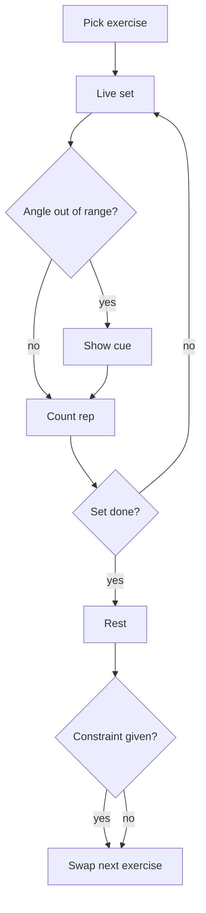

# Product Requirements Document (PRD)

**Project:** FormVision
**Date:** 2026-10-12
**Version:** 0.1
**Owner:** Aidan
**Status:** Draft
**Last reconciled:** N/A

---

## 1. Product Purpose & Value Proposition

FormVision is a Fire TV workout coach for someone training alone from a video. It shows their pose beside the target form and flags the joint that drifted. The person does not tap a remote to log the rep.

---

## 2. Target Personas

**Primary: Home-gym owner**: Trains from a TV video in the living room, often alone. Pain: the video cannot see a missed knee or a sagging hip. Success: one clear correction during the set.

**Secondary: Stick owner**: Has a Fire TV Stick and no TV camera. Pain: the same, plus no lens on the device. The phone bridge is the candidate path. Whether it is in the demo is [FILL].

---

## 3. Core Features & Priorities

| ID | Feature | Description | Priority |
|----|---------|-------------|----------|
| PRD-F1 | Live form cue | Show a skeleton and mark the joint that left the safe angle. Speak or show a short cue. Camera frames stay on the device. | Must-Have |
| PRD-F2 | Rep, set, and rest | Count reps from the same pose stream, end the set, start rest, and keep the set without a remote press. | Must-Have |
| PRD-F3 | Constraint swap | If the user states a limit such as sore knees or a short clock, replace the next exercise with one the camera can judge. | Must-Have |
| PRD-F4 | Camera source | Accept landmarks from an on-device camera or a phone bridge. Which path is first is [FILL]. | Must-Have |
| PRD-F5 | Accounts, history, payments | Profiles, charts, and store payments. | Won't-Have (this hackathon) |

---

## 4. User Stories & Acceptance Criteria

**US-01: See the fault** (PRD-F1)

> As a home-gym owner, I want the bad joint marked during the set so that I can fix it before the video moves on.

- Given a squat is selected and landmarks are arriving, when the knee angle crosses the exercise rule, then that joint is marked as a fault and a short cue is shown or spoken.
- Given the user corrects, when the angle returns inside the rule, then the joint is marked safe.

**US-02: Log the set without the remote** (PRD-F2)

> As a home-gym owner, I want reps and rest to happen on their own so that I do not stop to type.

- Given a set is in progress, when a rep completes, then the count increases by one.
- Given the set reaches its end condition, when the last rep finishes, then rest starts and the set is recorded on the device.

**US-03: Change the next exercise** (PRD-F3)

> As a home-gym owner, I want to say my knees are sore so that the next drill is one I can do.

- Given a plan is on screen, when the user submits "my knees are sore", then the next exercise changes to one that does not load the knees the same way, chosen from the small library.

**US-04: Keep video local** (PRD-F1, PRD-F4)

> As a home-gym owner, I want the camera picture to stay in the room so that a coach can still help.

- Given either camera path, when a cue is requested, then the payload off device is joint angles and rep state, not image frames.

The safe angles per exercise are [FILL].

---

## 5. App Flow & UX Intent

**Design reference:** [dsd-formvision.md](dsd-formvision.md)

### 5.2 Navigation Model & Information Architecture

**Primary navigation pattern:** D-pad on a 10-foot TV layout. No account gate.

| Destination | Maps to screen | Route / path | Auth required | Feature(s) |
|-------------|----------------|--------------|---------------|------------|
| Exercise pick | Picker | app open | No | PRD-F1 |
| Live set | Split screen | after confirm | No | PRD-F1, PRD-F2 |
| Rest and next | Timeline | set end or constraint | No | PRD-F2, PRD-F3 |

```
open -> pick exercise -> live set -> rest -> next exercise
```

**Global elements, auth boundaries, deep links:** No login. Camera permission denied is an error state, not a dead end: the screen says the camera is unavailable and returns to the picker.

### 5.3 App Flow

**Linear (primary path):** `Pick squat -> camera starts -> reps count -> fault cue -> rest -> optional constraint -> next exercise`



**Annotations:** entry is the picker. The fault branch returns to the set. Rest is not a dead end. Leaving the app abandons the in-memory set. Edge cases: camera denied, no landmarks, cue model timeout. Persistence of a killed session is [FILL].

---

## 6. Out of Scope for This Release

PRD-F5. Branching video. A second user profile. Any payment.

---

## 7. AI / Agent Feature Specifications

The cue model turns joint state and an optional constraint into one short sentence. It does not see frames. It does not decide the angle rule. The rule is plain code. If the model is slow or down, the joint marker still changes and a fixed fallback sentence is [FILL].

Model id is [FILL] (IDEA.md names Haiku or Nova Micro).

---

## 8. Dependencies & Assumptions

- A pose library that yields body landmarks. Exact package is [FILL] until the camera path is chosen.
- A cue model API. Credentials stay out of the repo.
- A1, A2, and A3 in state.md.

---

## 9. Implementation Plan

| # | Phase / Milestone | Entry criteria | Exit criteria | Owner (DRI) | Top risk |
|---|-------------------|----------------|---------------|-------------|----------|
| M1 | Requirements | IDEA drafted | Aidan accepts this Draft or marks cuts | Aidan | Camera path still [FILL] |
| M2 | Design | PRD accepted | RFC recommendation accepted or replaced | Aidan | Two paths stay open |
| M3 | Development | Path chosen | US-01 through US-04 pass on one path | Aidan | Spike fails. Effort UNCALIBRATED |
| M4 | Testing | Must-haves runnable | QAD rows for the demo pass | Aidan | Emulator camera |
| M5 | Demo rollout | QA passed | Demo video under 3 minutes on a device or emulator | Aidan | No Cube. [FILL] |
| M6 | After the hackathon | Demo submitted | Decide whether to keep the repo public and add a license | Aidan | License still [FILL] |

**Rollout strategy:** one demo build, because this slice has no production cohort.

**Rollback plan:**

- *Trigger criteria:* the demo build cannot complete one squat set.
- *Revert mechanism:* install the previous demo build. The exact command is [FILL] until the stack is chosen.

**RFC cross-reference:** [rfc-formvision-camera-path.md](rfc-formvision-camera-path.md)

---

## Self-Check

- [x] Must-haves have PRD-F# ids and Given/When/Then stories
- [x] Navigation has an auth rule and a way out of camera denial
- [x] AI behavior is stated
- [x] Rollback has a trigger and one revert idea
- [ ] Aidan has not accepted this Draft
