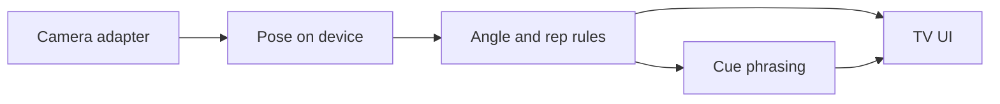

# System Design Document (SDD)

**Project:** FormVision
**Date:** 2026-10-12
**Version:** 0.1
**Owner:** Aidan
**Status:** Draft
**Last reconciled:** N/A

---

## 1. Architectural Vision & Principles

- Pose stays on the device that sees the camera. PRD-F1 and PRD-F4.
- The cue path receives numbers (joint angles and rep state), never frames.
- Angle rules are ordinary code. The model only phrases the cue and the exercise swap. PRD-F3.
- The camera adapter is replaceable so the unset path does not fork the rest of the app.

---

## 2. High-Level Architecture

The camera adapter is either an on-device capture or a phone bridge that sends landmarks. Which one is first is [FILL]. See the camera RFC.

Rapid note: bullets only until the path is chosen. No second data store.

---

## 3. Data Architecture

No accounts. The demo holds the current set in memory: exercise id, rep count, joint angles, cue text.

| Data | Where | Leaves the device? |
|------|-------|--------------------|
| Camera frames | On the capturing device | No |
| Landmarks and angles | In memory | Angles and rep state may go to the cue model |
| Constraint text | In memory | Yes, as the re-plan prompt |
| Set log | On device | [FILL] if a later history feature syncs it |

Retention for the demo: until the app process ends. A durable store is [FILL].

---

## 4. API Design & External Integrations

| Name | Direction | Purpose | Failure |
|------|-----------|---------|---------|
| Pose library | On device | Landmarks for PRD-F1 and PRD-F2 | UI shows the error state. No cue call |
| Cue model | Outbound | Phrase a cue or a swap for PRD-F1 and PRD-F3 | Show the joint marker and a fixed fallback line. Fallback text is [FILL] |
| Phone bridge | LAN, only if that path is chosen | Landmark numbers, not frames | Fall back is [FILL] |

N/A: single-hop. One cue request per fault or per constraint. No chain of tools.

Request: joint name, angle, exercise id, rep index, optional constraint string.
Response: one short cue string. Schema detail is [FILL] until the model is chosen.

Package names and versions are [FILL]. Do not pin them from memory.

---

## 5. Security & Authorization

- **Authentication:** none this slice. **Session:** in-memory only.
- **Authorization model:** single person in the room. No server-side user id.
- **PII at rest:** frames are not written to a store in this design. If a spike writes frames, that is a defect.
- **Secrets:** cue-model credentials live in the environment, never in the repo.
- **Input validation:** reject landmark payloads that are not numeric, and cap constraint text length. Limits are [FILL].

---

## 6. Infrastructure, CI/CD & Deployment

- **Hosting:** a demo app on a Fire TV, Vega, or Android TV emulator. No production host.
- **Environments:** local demo only.
- **CI/CD:** [FILL]. Engineering level is L0, so a pipeline is not required yet.
- **Backup & DR:** no production data store. RTO and RPO are not applicable until a store exists.

---

## 7. Non-Functional Requirements

| Requirement | Target | Notes |
|-------------|--------|-------|
| Fault to cue | IDEA.md states under 1.5 s | Measured: UNCALIBRATED |
| Pose rate | [FILL] | Must be steady enough to count a rep |
| Uptime | Not a production service | Demo session only |
| Concurrent users | 1 in the room | |
| Data retention | Process lifetime | Durable retention [FILL] |

---

## 8. AI / Agent Architecture

**AI approach:** Deterministic angle rules. A model writes the sentence and may pick the next exercise from a fixed list the camera can judge.

| Task | Model | Reason |
|------|-------|--------|
| Cue sentence | [FILL] | Short text from numbers. IDEA.md names Haiku or Nova Micro |
| Exercise swap | same or [FILL] | Must stay inside the known exercise list |

- **Context:** exercise id, joint, angle, rep count, optional constraint. No frame, no chat history required for v0.
- **Tools:** none. The model does not call device APIs.
- **HITL gates:** the user can ignore the cue. No payment or delete action.
- **Token / cost budget:** [FILL]. No measured rate. UNCALIBRATED.
- **Fallback:** marker still updates. Spoken cue is skipped if the model does not return before the next rep. Timeout is [FILL].

### 8.1 AI Safety & Threat Surface

| Risk | Control | Test |
|------|---------|------|
| Constraint text tries to override the angle rule | Rules stay in code. Model text is a sentence, not a command | QAD |
| Model invents an exercise the camera cannot judge | Swap must be one of the library ids | QAD |
| Prompt asks for medical diagnosis | Cue template forbids diagnosis and dosage. Copy is [FILL] | QAD |
| Landmark spam | Reject non-numeric payloads | QAD |

---

## Self-Check

- [x] Security section filled
- [x] Both camera paths fit the same cue contract
- [x] Trace ids point at PRD features
- [ ] Versions not pinned
